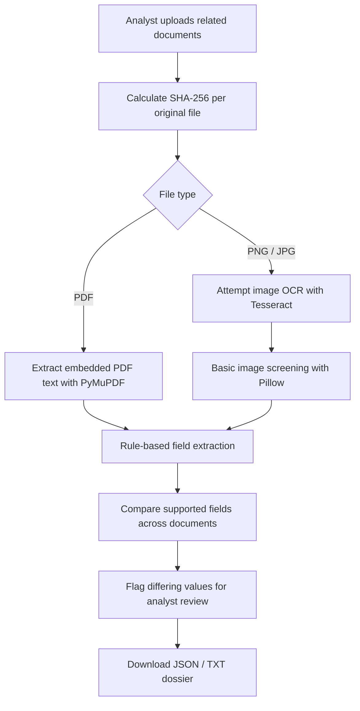

<div align="center">


### 🛡️ AI-Powered Document Forensics & Contextual Intelligence System

**Built by HACKNCODE · DataOps Innovation Hackathon 2026**

[](https://www.python.org/)
[](https://streamlit.io/)
[](https://pymupdf.readthedocs.io/)
[](https://python-pillow.org/)
[](#limitations--honest-scope)
[](#project-information)

**Turn scattered documents into traceable, review-ready evidence.**

</div>

---

## ✨ Overview

DOCUSHIELD AI is a document-investigation prototype designed to help an analyst examine multiple related records in one workflow. It extracts supported text fields, calculates SHA-256 evidence identifiers, compares values across documents, highlights inconsistencies for human review, and prepares a downloadable JSON/TXT investigation dossier.

> **Core principle:** a discrepancy is a reason to investigate—not proof of fraud. DOCUSHIELD AI keeps the human analyst in control.

## 🎬 Product preview

<div align="center">


&nbsp;→&nbsp;

&nbsp;→&nbsp;

&nbsp;→&nbsp;


</div>

## 🚀 Current features

| Feature | What it does | Current implementation |
|---|---|---|
| Multi-document intake | Accepts PDF, PNG, JPG and JPEG uploads | Streamlit uploader |
| Evidence identifier | Calculates SHA-256 from original uploaded bytes | Python `hashlib` |
| PDF text extraction | Reads embedded text from PDF pages | PyMuPDF |
| Image OCR | Attempts text extraction from uploaded images | Optional Tesseract + `pytesseract` |
| Structured extraction | Looks for name, DOB, document ID, address, amount and email | Transparent regular expressions |
| Cross-document comparison | Flags differing extracted values across submitted files | Rule-based comparison |
| Basic image screening | Reports image dimensions/format and a JPEG recompression difference heuristic | Pillow |
| Investigation dossier | Provides downloadable JSON/TXT report data | Streamlit download controls |
| Human-review workflow | Labels discrepancies as requiring review | Analyst-led process |

## 🧭 Application workflow



## 🖥️ Screens and modules

- **New Investigation** — upload documents, run extraction and inspect hashes and extracted values.
- **Findings & Correlation** — compare extracted fields and review discrepancies.
- **Investigation Dossier** — inspect and download the generated report data.
- **Methodology & Limits** — understand the processing approach and its boundaries.

## ⚙️ Installation

### Requirements

- Python 3.10 or newer
- pip
- Tesseract OCR installed separately only if image OCR is required

### 1. Clone the repository

```bash
git clone https://github.com/parag1020/HACKNCODE-DOCUSHIELD-AI.git
cd HACKNCODE-DOCUSHIELD-AI
```

### 2. Create and activate a virtual environment

**Windows (PowerShell):**

```powershell
python -m venv .venv
.\.venv\Scripts\Activate.ps1
```

**Linux / macOS:**

```bash
python3 -m venv .venv
source .venv/bin/activate
```

### 3. Install dependencies

```bash
python -m pip install --upgrade pip
pip install -r requirements.txt
```

### 4. Launch DOCUSHIELD AI

```bash
streamlit run app/streamlit_app.py
```

Open the local address printed by Streamlit (usually `http://localhost:8501`).

### Optional: enable image OCR

Install the Tesseract OCR engine for your operating system and ensure its executable is available on your system PATH. The Python package `pytesseract` is listed in `requirements.txt`. If the OCR engine is unavailable, image OCR will report that it cannot run.

**Note:** scanned PDFs are not OCR-processed by this prototype. The current PDF path extracts embedded text only.

## 🧪 Quick demo

1. Start the app using the command above.
2. Open **New Investigation**.
3. Upload the synthetic examples from `sample_data/` (for example, `sample_application.pdf` and `sample_conflicting_record.pdf`).
4. Click **Analyze submitted documents**.
5. Inspect the SHA-256 identifiers and extracted fields.
6. Open **Findings & Correlation** and review any conflicting values.
7. Open **Investigation Dossier** and download the available JSON/TXT output.

The sample records are fictional demonstration material. They are not real identity documents or evidence about real people.

## 🗂️ Repository structure

```text
HACKNCODE-DOCUSHIELD-AI/
├── app/
│   └── streamlit_app.py
├── docs/
│   ├── ARCHITECTURE.md
│   └── DEMO_SCRIPT.md
├── sample_data/
│   ├── DOCUSHIELD_Sample_Investigation_Dossier.pdf
│   ├── sample_application.pdf
│   ├── sample_conflicting_record.pdf
│   └── sample_supporting_record.pdf
├── HACKNCODE_DOCUSHIELD_AI_Presentation.pptx
├── requirements.txt
├── SUBMISSION_CHECKLIST.txt
└── README.md
```

## 🔐 Privacy, evidence handling & safety

- Use synthetic data or documents you are explicitly authorized to process.
- Uploaded content is processed in the active Streamlit session; this prototype does not implement a persistent evidence database.
- SHA-256 identifies the uploaded byte sequence. It does not prove that a document is genuine or that its contents are true.
- OCR and text extraction may be incomplete or incorrect.
- A flagged mismatch must be checked against original documents and authoritative sources.
- Do not use prototype output as the sole basis for employment, financial, legal, identity, or other consequential decisions.

## ⚠️ Limitations & honest scope

DOCUSHIELD AI is a hackathon prototype—not a production forensic platform. The following capabilities are **not implemented** and must not be assumed:

- LLM-powered contextual reasoning or autonomous AI-agent analysis
- OCR for scanned PDF pages
- Digital-signature or certificate validation
- Issuer, government database, or external source verification
- Pixel-level tamper localization or conclusive image manipulation detection
- Persistent case database, user authentication, or role-based access control
- PDF export of the generated in-app dossier (the current report downloads are JSON/TXT)
- Legal certification or formal compliance with forensic standards

The JPEG recompression check is an experimental screening heuristic only. It cannot establish whether an image has been manipulated. Regular-expression extraction supports only a limited set of field formats.

## 🧱 Architecture & demo documentation

- [`docs/ARCHITECTURE.md`](docs/ARCHITECTURE.md) — processing flow, data flow and trust boundaries.
- [`docs/DEMO_SCRIPT.md`](docs/DEMO_SCRIPT.md) — short judge-facing demonstration script.
- [`SUBMISSION_CHECKLIST.txt`](SUBMISSION_CHECKLIST.txt) — submission preparation checklist.

## 👥 Team HACKNCODE

| Name | Role |
|---|---|
| **Parag Patel** | Team Leader |
| **Dhruvi Dave** | Team Member |
| **Dhruvansh Dave** | Team Member |

## 🛠️ Technology stack

- **Language:** Python
- **User interface:** Streamlit
- **PDF processing:** PyMuPDF
- **Image handling:** Pillow
- **Optional OCR adapter:** pytesseract + external Tesseract OCR engine
- **Core analysis:** SHA-256 hashing, regular-expression extraction and rule-based comparison

## 🧩 Future roadmap

These are potential future enhancements, not current features:

- Scanned-PDF OCR with page-level provenance
- Configurable extraction schemas and multilingual support
- Analyst annotations and auditable case history
- Verified issuer integrations where lawful and available
- Stronger image-forensics methods with explainable indicators
- Secure case storage, access controls and exportable evidence packages
- Optional human-supervised language-model assistance with source-grounded explanations

## 📚 Reference frameworks

The project design may be informed by digital-evidence guidance such as **ISO/IEC 27037**, **ISO/IEC 27042** and **NIST SP 800-86**. Mention of these references does not mean this prototype is certified, compliant, or formally validated against them.

## 📌 Project information

- **Project:** DOCUSHIELD AI
- **Team:** HACKNCODE
- **Event:** DataOps Innovation Hackathon 2026
- **Version:** Hackathon prototype v1.0
- **Repository:** https://github.com/parag1020/HACKNCODE-DOCUSHIELD-AI

---

<div align="center">

### 🛡️ DOCUSHIELD AI — Investigate Beyond OCR.

*Trace the document. Compare the context. Keep the analyst in control.*

<sub>Built with care by Team HACKNCODE · 2026</sub>

</div>
